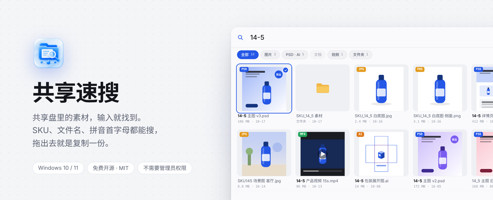
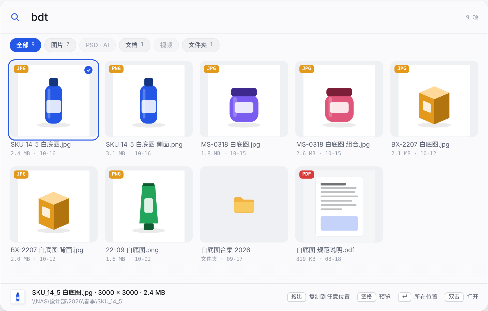
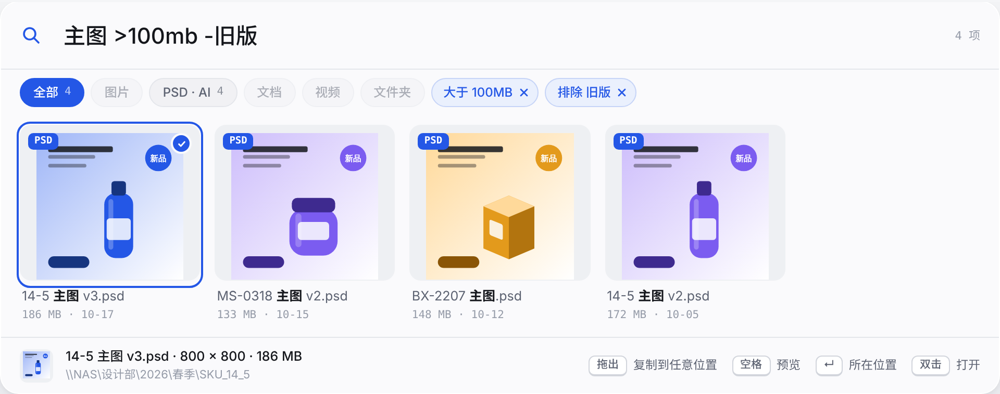

<p align="center">
  
</p>

<p align="center">
  <a href="https://github.com/oldleeo/SharedQuickSearch/releases/latest"></a>
  <a href="https://github.com/oldleeo/SharedQuickSearch/releases"></a>
  
  
  <a href="LICENSE"></a>
</p>

<p align="center">
  <a href="https://github.com/oldleeo/SharedQuickSearch/releases/latest/download/SharedQuickSearch-Setup.exe"><b>下载安装包</b></a>
  &nbsp;·&nbsp;
  <a href="https://oldleeo.github.io/SharedQuickSearch/">官网和在线演示</a>
  &nbsp;·&nbsp;
  <a href="CHANGELOG.md">更新记录</a>
  &nbsp;·&nbsp;
  <a href="PRIVACY.md">隐私说明</a>
</p>

---

**共享速搜**是给设计部用的 Windows 共享盘搜索工具。在任何地方按 <kbd>Ctrl</kbd> <kbd>Alt</kbd> <kbd>Space</kbd>，输入 SKU、文件名或拼音首字母，缩略图马上出来；拖出去就是复制一份，共享盘上的原文件永远不动。

它不联网、不上传、只读共享盘，安装不需要管理员权限。

<p align="center">
  
  <br>
  <sub>动图录自 <a href="https://oldleeo.github.io/SharedQuickSearch/">官网上的网页演示</a>，按软件界面复刻，用的是示例文件。</sub>
</p>

## 目录

- [为什么做它](#为什么做它)
- [功能](#功能)：[搜索](#搜索随手写也能找到) · [缩略图](#缩略图看过的下次不再等) · [拖出复制](#拖出去就是复制原文件永远不动) · [空格预览](#空格看大图滚轮看细节) · [工作台](#要看一大片时展开成工作台) · [实时同步](#索引自己保持最新) · [安装与引导](#安装首次引导卸载)
- [快捷键](#快捷键)
- [隐私与安全](#隐私与安全)
- [技术细节](#技术细节)
- [性能数据](#性能数据)
- [从源码编译](#从源码编译)
- [目前做不到的](#目前做不到的)

## 为什么做它

设计部的共享盘，几万到几十万个文件很常见。下面这些事每天都在发生：

| 以前 | 用共享速搜 |
|---|---|
| 在资源管理器里搜共享盘，转圈几分钟，还经常搜不全 | 搜的是本机建好的索引，不再翻共享盘。20 万个文件，输入后几十毫秒出结果 |
| 同一个款，有人写 `14-5`，有人写 `14_5`、`SKU145`，搜一种写法漏掉另外两种 | 空格、横线、下划线、点都忽略，三种写法找到的是同一批文件 |
| 中文文件名要切输入法才能搜，打错一个字就没了 | 拼音和首字母都能搜：`bdt` 是“白底图”，`zt` 是“主图”，`xqy` 是“详情页” |
| 缩略图一张张慢慢冒出来，PSD 要等更久，翻一页等半天 | 看过的图存在本机，下次 0 毫秒出现；PSD 只读文件开头存的预览图 |
| 拖文件时手一抖，把共享盘上的原文件拖走了，全组找了一下午 | 从共享速搜拖出去只能是复制，按着 Shift 也变不成移动 |
| 找到文件名还得一层层点进文件夹，才能把文件拿出来用 | 回车打开所在位置，双击打开文件，<kbd>Ctrl</kbd> <kbd>Shift</kbd> <kbd>C</kbd> 复制文件 |

## 功能

### 搜索：随手写，也能找到

第一次打开时扫描一遍共享盘，把文件名、大小、修改时间存成本机索引。之后每次搜索只查这份索引，共享盘在不在线都能搜。

<table>
  <tr>
    <td width="50%"></td>
    <td width="50%"></td>
  </tr>
  <tr>
    <td align="center"><sub><code>14-5</code>：SKU_14_5、14_5、SKU145 一起找到，命中部分加粗</sub></td>
    <td align="center"><sub><code>bdt</code>：拼音首字母，找到所有“白底图”</sub></td>
  </tr>
</table>

- **SKU 容错**：空格、横线、下划线、点都忽略，`14-5` = `14_5` = `145`。
- **拼音**：全拼和首字母都行。拼音表覆盖 U+4E00–U+9FA5 区间的 20,892 个汉字，多音字只认一个常用读音。
- **逐字筛选**：后一个字只在上一次的结果里找，打字时通常 0–3 毫秒。
- **分类计数**：图片、PSD · AI、文档、视频、文件夹，各有多少一眼看到，<kbd>Tab</kbd> 切换。
- **最近使用**：搜索框为空时按 <kbd>↓</kbd>，出现最近打开、复制、拖出过的 30 个文件。
- **剪贴板预填**：刚复制了一个货号，呼出时自动填好。只在本机读一次，同一段内容只填一次，设置里可以关。

搜索框里可以直接写条件。识别出来的条件会变成蓝色胶囊，点 × 就去掉：

<p align="center">100mb -旧版，出现“大于 100MB”和“排除 旧版”两个胶囊" width="760"></p>

| 写法 | 意思 |
|---|---|
| `psd` `.jpg` `*.ai` | 按格式，可以写好几个，任一命中 |
| `图片` `设计稿` `文档` `视频` `文件夹` | 按分类 |
| `>50mb` `<1mb` `>500k` `>2g` | 按大小，不写单位按 MB |
| `今天` `昨天` `本周` `本月` `7天` `30d` | 按修改时间 |
| `-旧版` | 排除名字里有“旧版”的 |

### 缩略图：看过的，下次不再等

<p align="center"></p>

- **本机缓存**：生成过的缩略图都存在本机，默认上限 2 GB，满了删最久没看的。重开软件也是瞬间显示。
- **后台预热**：电脑空闲时按修改时间从新到旧提前生成；你一开始翻就自动暂停，不抢带宽。超过 4 MB 又没有内嵌预览的文件不预热，等真正看到再生成。
- **先糊后清**：JPG 先显示文件里自带的约 160 px 小图，后台换成 256 px 清晰版，自动替换。
- **自动转正**：手机和相机拍的照片按 EXIF 方向转正。
- **只加载看得见的**：屏幕上的几行加上往下两行，滚动时每 60 毫秒补一次。

> 第一次见到、又没有内嵌预览的大文件（没存缩略图的 PSD、大 TIFF、视频）还是要从共享盘读，速度取决于网络和 NAS。PSD 想要快，Photoshop 里“首选项 → 文件处理 → 图像预览”要设成“总是存储”。

### 拖出去就是复制，原文件永远不动


拖到桌面、文件夹、微信、Photoshop 都行。软件告诉 Windows 这次拖拽**只允许复制**，所以目标位置拿到的是一份副本，按着 Shift 也变不成移动。

- Ctrl 点选、Shift 连选，选中的一起拖。拖拽图会叠成一摞，角上写着数量。
- 复制成功后卡片闪一下对勾，底栏写明复制了几个文件。
- 不想拖就按 <kbd>Ctrl</kbd> <kbd>Shift</kbd> <kbd>C</kbd>，到别处 <kbd>Ctrl</kbd> <kbd>V</kbd>。

<br clear="right">

### 空格看大图，滚轮看细节

<p align="center"></p>

- 选中一张按空格，缩略图从网格里**原地放大**，清晰大图到了再无缝换上。<kbd>←</kbd> <kbd>→</kbd> 看下一张，再按空格缩回原来的位置。
- 滚轮以鼠标位置为中心放大，最多到原图像素的 4 倍（小图至少能放大到 4 倍）；放大后按住拖动。
- 双击在“适应窗口”和“原始尺寸”之间切换，<kbd>+</kbd> <kbd>-</kbd> <kbd>0</kbd> 也能用，左下角显示当前比例。
- JPG、PNG、TIFF 放大到看得出糊时，自动换更大的图，最长边到 6000 px。PSD、AI、PDF 的清晰度取决于文件里存的预览图，大约 1024 px。

### 要看一大片时，展开成工作台


点搜索条右上角，或按 <kbd>Ctrl</kbd> <kbd>Shift</kbd> <kbd>Enter</kbd>，同一块面板原地变大：网格变宽，右边多一栏详情。不是跳到另一个长得不一样的窗口。

- 详情栏：大图、尺寸、大小、修改时间、完整路径，四个常用操作。
- “查看同 SKU 的全部文件”一键搜同款。
- 拖动右下角改大小，列数跟着变，下次打开还是这个大小。
- 刷新索引、主题切换、设置都在顶部；底栏显示索引状态。
- 搜索条切到别的程序就收起、始终置顶；工作台是普通窗口，切走还在，任务栏有图标。

<br clear="right">

### 索引自己保持最新

- **实时监听**：新建、改名、删除、覆盖保存都会更新。同事放进共享盘的新图，测试里 1 秒以内就能搜到；你正在看的结果里会出现它，选中和滚动位置不变。
- **合并写盘**：短时间内的多次变化 4 秒合并写一次索引文件，退出前把没写的存下来。
- **定期校准**：每 2 小时（加随机错峰）快速核对一遍：目录修改时间没变就沿用上次的内容，不列目录。监听丢了事件（缓冲溢出、网络闪断）时 20 秒后自动校准一次。
- **断线也能搜**：NAS 离线时用上一次的快照，结果标出“离线快照”，界面不卡。共享盘上线后自动重试之前没出图的文件。

### 安装、首次引导、卸载

- **一个文件安装**：安装包就是程序本身，双击出现和软件同风格的安装界面。默认装到 `%LocalAppData%\Programs\共享速搜`，只装给当前用户，不需要管理员权限。已经装过会自动升级，设置和索引都保留。
- **首次引导**：① 粘贴共享盘路径（比如 `\\NAS\设计部`），马上检查能不能连上；电脑上映射好的网络盘会列出来一键添加。② 读取每个目录的第一层文件夹，回收站（`#recycle`、`$RECYCLE.BIN`）、群晖缩略图缓存（`@eaDir`）、快照这类默认排除；名字像“备份 / 旧版 / 归档”的只标出来，不替你决定。③ 开机启动、搜索条、剪贴板预填。④ 开始扫描。
- **使用教学**：扫描在后台跑的同时，播放 5 张一分钟看完的动画卡片。以后在托盘菜单和“设置 → 关于”里能重新打开。
- **卸载**：Windows“设置 → 应用 → 共享速搜”。删除程序、快捷方式、开机启动项和卸载信息；设置、索引、缩略图缓存默认保留，勾选后一并删除。卸载只认这台电脑登记过的安装位置，拒绝任何网络路径。

## 快捷键

| 按键 | 作用 |
|---|---|
| <kbd>Ctrl</kbd> <kbd>Alt</kbd> <kbd>Space</kbd> | 在任何地方呼出 / 收起搜索条（设置里可改） |
| <kbd>↓</kbd> <kbd>←</kbd> <kbd>→</kbd> <kbd>↑</kbd> | 进入结果、移动选中；搜索框为空时 <kbd>↓</kbd> 显示最近使用 |
| <kbd>Space</kbd> | 预览；再按一次关闭 |
| <kbd>Enter</kbd> | 打开所在位置；选中文件夹就直接打开它 |
| 双击 / <kbd>Ctrl</kbd> <kbd>Enter</kbd> | 打开文件 |
| <kbd>Ctrl</kbd> <kbd>C</kbd> | 复制完整路径 |
| <kbd>Ctrl</kbd> <kbd>Shift</kbd> <kbd>C</kbd> | 复制文件，到别处直接粘贴 |
| <kbd>Ctrl</kbd> <kbd>Shift</kbd> <kbd>Enter</kbd> | 展开 / 收回工作台 |
| <kbd>Ctrl</kbd> <kbd>A</kbd> | 全选当前结果 |
| <kbd>Tab</kbd> | 切换分类 |
| <kbd>Ctrl</kbd> <kbd>,</kbd> | 设置 |
| <kbd>Esc</kbd> | 先清空搜索，再按一次收起 |

## 隐私与安全

给全组装之前，这几件事最好先说清楚。每一条都可以在代码里查到。

| 会做的 | 不会做的 |
|---|---|
| 读取你指定文件夹里的文件名、大小、修改时间，建本机索引 | 不改、不删、不移动、不重命名共享盘上的任何文件 |
| 预览时读取文件，或调用 Windows 自带的缩略图组件 | 没有账号、没有统计、不联网，文件名和路径不会离开这台电脑 |
| 把索引、设置、缩略图缓存存在当前用户目录 | 不保存剪贴板内容 |
| 只写当前用户的注册表（HKCU）：卸载信息、可选的开机启动 | 不写 HKLM，不装服务，不需要管理员权限 |
| 开启剪贴板预填时，呼出那一刻在本机读一次剪贴板文字 | 卸载时不碰共享盘，只删本机的程序和快捷方式 |

完整说明见 [PRIVACY.md](PRIVACY.md)。

## 技术细节

<p align="center"></p>

用 .NET 8 + WPF 写，Windows 10 / 11，自包含单文件发布（不用另装 .NET）。约 9,500 行 C# 和 3,000 行 XAML。

<details>
<summary><b>索引与并发</b>（<code>FileIndexService.cs</code>、<code>IndexMonitorService.cs</code>）</summary>

- 所有写操作（扫描提交、实时变更、排除规则）都经过同一把异步锁串行执行；搜索只读**不可变快照**，不加锁、不等待。
- 扫描进行时到达的实时变更先记下来，扫描结果提交后再补上，不会丢，也不会被扫描结果覆盖。
- 每条记录预先算好：小写文件名、相对根目录的路径、去分隔符后的紧凑串、拼音全拼和首字母。
- 快速校准：目录修改时间和上次一样，就直接沿用上次的子项，不再列目录内容。新增、删除、改名都会改变所在目录的修改时间，所以能发现；只有“原地覆盖保存”发现不了，这部分由实时监听负责。
- `FileSystemWatcher` 缓冲区设为 64 KB；缓冲溢出或网络中断时发出“需要校准”事件，20 秒防抖后做一次快速校准。
- 保存合并：变更后 4 秒内的多次修改只写一次文件；扫描完成立即写；退出前 Flush。索引文件不写界面派生字段，体积更小、载入更快。
- 自动忽略 `Thumbs.db`、`ehthumbs.db`、`desktop.ini`、`.DS_Store`。

</details>

<details>
<summary><b>搜索与拼音</b>（<code>QueryParser.cs</code>、<code>Pinyin.cs</code>）</summary>

- `QueryParser` 把输入拆成：文字条件、扩展名、分类、最小 / 最大尺寸、修改时间下限、排除词。每个识别出的条件带一个显示标签，界面上变成可删除的胶囊；删除时按同样的分隔符（含全角空格、Tab）把原文去掉。
- 文字匹配三条路：去掉空格 / 横线 / 下划线 / 点之后的紧凑串（SKU 容错）、拼音全拼、拼音首字母。
- 拼音表 `Assets/pinyin.dat` 嵌在程序里，一行一个字，覆盖 U+4E00–U+9FA5 区间的 20,892 个汉字，每字取一个常用读音。
- 单个字符只匹配文件名，不匹配路径，避免输入“1”时被 IP 地址、年份目录拖慢。
- 纯文字继续往后输入时，结果一定是上一次结果的子集，所以只在上次结果里筛（前缀缓存，上限 8 万条）。
- 候选超过 2 万条时用 PLINQ 多核并行匹配。

</details>

<details>
<summary><b>缩略图管线</b>（<code>ThumbnailService.cs</code>、<code>EmbeddedThumbnailLocator.cs</code>、<code>ThumbnailDiskCache.cs</code>）</summary>

- 五层逐层尝试，命中即停：内存 LRU（360 张）→ 本机磁盘缓存 → Windows 缩略图缓存（`InCacheOnly`，不读文件内容）→ 文件头内嵌预览图 → 完整生成（图片用 WIC 按目标尺寸缩放解码，其他走 Shell）。
- 内嵌预览图：PSD 读图像资源段里的 1036 号资源（同时认 `8BIM`、`8B64`、`MeSa` 等签名）；JPG 读 EXIF 里的缩略图，最多读前 192 KB；AI / PDF / INDD 在 XMP 里找缩略图，先读 512 KB，找不到再扩到 4 MB。
- 磁盘缓存是自定义的 `.sqt` 文件（16 字节头：`SQT1`、原图宽、原图高、标志位，后面是 JPEG 或 PNG）。键是“完整路径 + 修改时间 + 大小”，文件一改自然失效，不用比对内容。放在 Local 而不是 Roaming，避免漫游配置同步几个 GB。
- Shell 缩略图组件要求 STA 线程：用两个专用 STA 线程池：缓存探测 2 个线程，生成 4 个线程（低优先级，不跟界面抢）。
- 所有层都失败的文件记一个失败标记，同一版本不再重试；共享盘重新上线时清掉这些标记。
- 精修（把内嵌小图换成清晰版）只做还在屏幕上的文件，队列上限 48，超过 24 MB 的文件不为清晰度整份读取。

</details>

<details>
<summary><b>界面与动画</b>（<code>SpotlightWindow*.cs</code>、<code>FrameRate.cs</code>、<code>Themes/</code>）</summary>

- 搜索条和工作台是同一个透明无边框窗口。面板按完整高度排好版，展开 / 收起只动画裁剪区域（`RectangleGeometry`）和阴影高度，不触发重新排版。
- 网格按行虚拟化：每行一个 `UniformGrid`，几百个结果也只创建看得见的几行。列数在工作台里随宽度变化。
- 平滑滚动：滚轮改的是一个动画驱动的依赖属性，再同步到 `ScrollViewer`；拖滚动条时自动同步目标位置。
- 帧率：启动时读取所有显示器里最高的刷新率（120 / 144 / 165 Hz），改写 `Timeline.DesiredFrameRate` 的默认值，高刷屏上动画是满帧的。清单里声明 Per-Monitor V2 DPI。
- 空格预览用共享元素转场：从卡片里缩略图实际绘制的那块区域放大到目标位置；缩放以鼠标为锚点，拖动时限制边界。
- 浅色 / 深色 / 跟随系统三套主题，全部颜色用 `DynamicResource`，切换时整窗口实时换色。

</details>

<details>
<summary><b>拖出只复制</b>（<code>DragOut.cs</code>）</summary>

- `DoDragDrop` 只给出 `DragDropEffects.Copy`，并写入 `Preferred DropEffect = 复制`。目标程序拿到的只能是复制操作。
- 数据对象用 `SHCreateDataObject` 创建的系统 Shell 数据对象，直接写 `CF_HDROP`，这样才能挂上 `IDragSourceHelper` 的拖拽图（WPF 自带的 DataObject 不支持，拖拽图会静默失败）。
- 拖拽图是最多 3 张缩略图叠成一摞再加数量角标，预乘 alpha 的 32 位 DIB。
- 拖拽时不在界面线程上逐个检查文件是否存在（共享盘上每个都是一次网络往返）；离线快照里的条目不拖。

</details>

<details>
<summary><b>安装与卸载</b>（<code>Setup/</code>、<code>App.xaml.cs</code>）</summary>

- 安装包和程序是同一个 exe：文件名里带“安装”或“Setup”、或带 `--install` 参数时进入安装界面；`--uninstall` 进入卸载。判断在单实例互斥锁之前，安装程序不会占用主程序的实例。
- 安装时把自己复制成 `共享速搜.exe.new`，完整写完、校验大小后再替换；旧文件先改成不重复的 `.old-<guid>` 再删，正在运行的旧版本也不会让升级失败。
- 升级前通过命名事件请正在运行的程序退出；只找当前登录会话、从安装位置启动的进程。老版本不响应时，界面问你是否强制关闭。
- 程序不能删除正在运行的自己：卸载时先把自己复制到临时目录运行，结束后临时副本自删，并清理 .NET 单文件解压到 `%TEMP%\.net` 的运行库。
- 卸载只认注册表里登记的安装位置；`--target` 参数必须和它一致；网络路径和映射的网络盘一律拒绝；目录只在名字是“共享速搜”且已经空了时才删。

</details>

## 性能数据

后端测试（`tests/SharedQuickSearch.CoreTests`）在 2 核云服务器上，用 20 万条模拟索引跑出来的结果。普通 4 核以上的台式机会更快。

| 场景 | 耗时 |
|---|---|
| 载入 20 万条索引（含拼音预计算） | 约 1.7–2.3 秒，只在启动时一次 |
| 搜索 `14-5`（约 120 条命中） | 5–27 ms |
| 搜索 `14-5 psd` | 约 26 ms |
| 搜索 `主图 >50mb` | 约 28 ms |
| 搜索 `bdt`（约 2 万条命中） | 40–130 ms，受机器负载影响 |
| 逐字输入 `14-5 白底`，第一个字之后每次按键 | 0–37 ms |
| 第一个字 `1`（12 万条命中） | 约 170 ms |

## 项目结构

```
SharedQuickSearch/
├─ src/SharedQuickSearch/
│  ├─ SpotlightWindow.xaml(.cs)      搜索条 / 工作台
│  ├─ SpotlightWindow.Workbench.cs   呼出、收起、工作台、详情栏
│  ├─ SpotlightWindow.Zoom.cs        空格预览的缩放和拖动
│  ├─ FileIndexService.cs            本机索引、搜索、快照、校准
│  ├─ IndexMonitorService.cs         实时监听
│  ├─ QueryParser.cs / Pinyin.cs     搜索语法、拼音
│  ├─ ThumbnailService.cs            五层缩略图管线、预热、精修
│  ├─ EmbeddedThumbnailLocator.cs    PSD / JPG / AI / PDF 内嵌预览图
│  ├─ ThumbnailDiskCache.cs          本机 .sqt 缓存
│  ├─ DragOut.cs                     只复制的拖拽 + 拖拽图
│  ├─ OnboardingWindow.xaml(.cs)     首次引导、使用教学
│  ├─ Setup/                         安装、升级、卸载
│  ├─ MainWindow.xaml(.cs)           后台宿主：托盘、快捷键、索引调度
│  └─ Themes/                        浅色 / 深色 / 控件样式
├─ tests/
│  ├─ SharedQuickSearch.CoreTests/   跨平台后端测试（索引、搜索、拼音、内嵌缩略图、性能）
│  └─ SharedQuickSearch.Tests/       Windows 端测试
├─ docs/                             官网（GitHub Pages）
├─ .github/workflows/release.yml     打标签自动编译发布
├─ build.ps1                         本机一键编译、测试、生成安装包
└─ CHANGELOG.md / PRIVACY.md / LICENSE
```

## 从源码编译

需要 Windows 10 / 11 和 [.NET 8 SDK](https://dotnet.microsoft.com/download/dotnet/8.0)。

```powershell
git clone https://github.com/oldleeo/SharedQuickSearch.git
cd SharedQuickSearch
.\build.ps1
```

`build.ps1` 会还原、编译、跑两组测试，然后发布自包含单文件程序。结果在：

- `publish\共享速搜.exe`：程序本身
- `installer\共享速搜-<版本>-安装.exe` 和 `installer\SharedQuickSearch-Setup.exe`：安装包（同一个文件，文件名带“安装 / Setup”时打开安装界面）
- `installer\SharedQuickSearch-Portable.exe`：便携版，直接运行。
- `installer\SHA256SUMS.txt`：安装版和便携版的 SHA-256 校验值。

默认从 NuGet 还原依赖，适用于第一次编译。依赖已缓存时可运行 `./build.ps1 -Offline` 离线构建；任何还原、编译、测试或发布步骤失败都会立即停止。

只跑后端测试（Linux、macOS 也能跑）：

```bash
dotnet run --project tests/SharedQuickSearch.CoreTests -c Release
```

**发布新版本**：改 `src/SharedQuickSearch/SharedQuickSearch.csproj` 里的 `<Version>`，在 [CHANGELOG.md](CHANGELOG.md) 写好说明，然后推送标签：

```bash
git tag v1.8.0
git push origin v1.8.0
```

GitHub Actions 会在 Windows 上跑测试、编译，把 `SharedQuickSearch-Setup.exe` 发布到 Releases。官网（`docs/` 文件夹，Settings → Pages → `main` / `docs`）的下载按钮会自动读取最新版本。

## 目前做不到的

- **只有 Windows 版。** 用的是 WPF 和 Windows 的缩略图、拖拽组件，没有 Mac 版的计划。
- **每台电脑各自建索引。** 全组共用一份索引和缩略图缓存还没做，每个人第一次都要扫一遍。
- **只搜文件名，不搜文件内容。** PSD 里的图层名、PDF 里的文字搜不到。
- **多音字只认一个读音。** 比如“长”只认 zhang，搜 chang 找不到。
- **快速校准看不到“原地覆盖保存”。** 这类修改靠实时监听；监听断过的话，要等下一次完整扫描（手动“刷新索引”）。
- **没有代码签名。** 第一次运行 Windows SmartScreen 会提示“已保护你的电脑”，点“更多信息 → 仍要运行”；公司的杀毒软件也可能要求放行。

## 计划中

下面这些在想，还没开始做，不保证做、也不保证时间：

- 按颜色搜索、找相似图和重复文件
- 两张图并排对比
- 复制时转成 JPG、打包成 zip、复制时按规则改名
- 双击 Ctrl 呼出
- 全组共享的缩略图缓存（默认关闭，管理员指定一个共享文件夹）
- 收藏常用文件和文件夹

有想法或者遇到问题，欢迎开 [Issue](https://github.com/oldleeo/SharedQuickSearch/issues)。提 Bug 时附上 `%AppData%\Oldlee\共享速搜\error.log` 会快很多（里面是程序的报错信息，可能带出错文件的路径，发之前可以自己看一眼）。

## 协议与作者

[MIT](LICENSE)：商用、修改、再分发都可以，保留版权声明即可。

作者 [@老李Oldlee](https://x.com/oldleeoo)。
